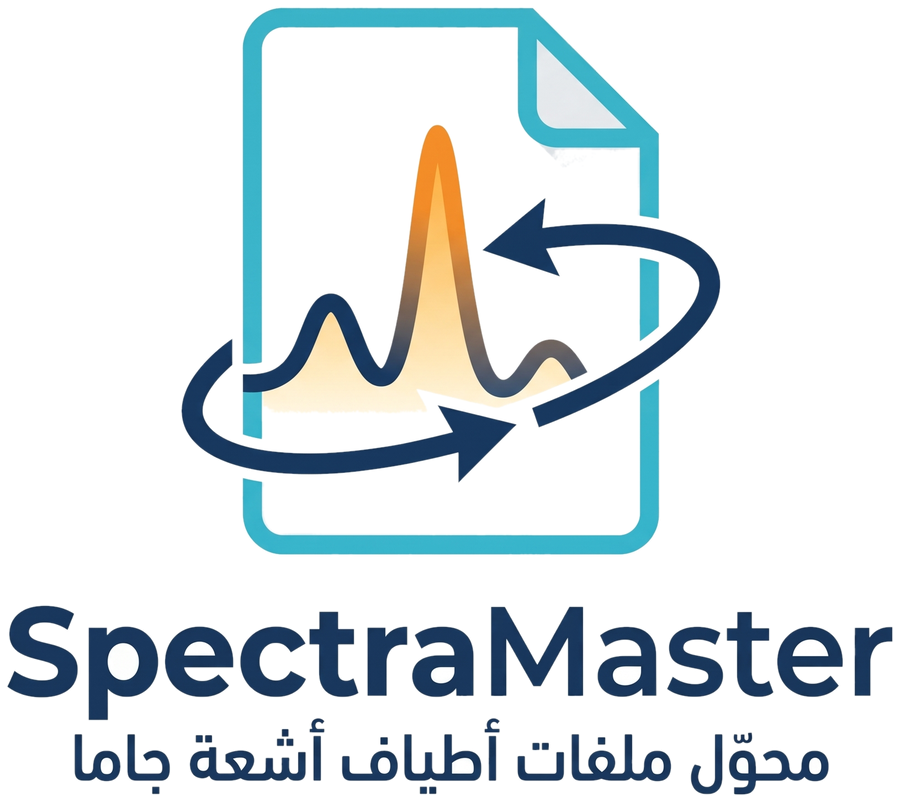

<p align="center"></p>

# SpectraMaster

**Gamma-spectrum file converter and analysis tool** — a modern, DataMaster-style program for
radiation measurement laboratories. Designed & developed by **Edrees F. Hery**.

> **محوّل ملفات أطياف أشعة جاما** — برنامج لتحويل ملفات الأطياف بين صيغ البرامج والأجهزة
> المختلفة وعرضها وتحليلها، بواجهة عربية وإنجليزية.

## Features

- **59 spectrum formats** (58 readable, 35 writable): ORTEC CHN/SPC, Canberra CNF (written natively,
  verified with Genie 2000), IAEA SPE, IEC 1455, N42-2006/2012, GADRAS PCF, Excel, JSON, all
  ORTEC DataMaster formats, Aptec MCA `.S0` (v3.0–v6.3) and every Aptec import format.
- **DataMaster-compatible command line** (`-13 in.S0 -1 out.chn`) and GammaVision/MAESTRO
  external import/export integration.
- **Viewer**: box zoom with history, overview strip, log/sqrt scales, ROIs with net areas,
  overlays, PNG/SVG export.
- **Peak search & nuclide identification** with a library built from IAEA ENSDF and SandiaDecay data.
- **Efficiency calibration, activity (Bq, Bq/kg) and MDA** (Currie / ISO 11929), decay corrections.
- **Printed / PDF reports** with selectable content and templates.
- **Archive search** (SQLite index, Arabic-aware text search, nuclide/date filters).
- **Detector QC** control charts (Shewhart limits, Westgard rules).
- **Bilingual UI** (English default, Arabic RTL) and user manuals in both languages (`docs/`).

## Download

Get the Windows installer from **[Releases](../../releases)** (`SpectraMaster_Setup_1.0.0.exe`).
It is not code-signed yet: on first run choose *More info → Run anyway* in the SmartScreen prompt.

## Running from source

Requires Python 3.12+ on Windows.

```bash
pip install PySide6 numpy scipy openpyxl SandiaSpecUtils
python -m spectramaster            # GUI
python -m spectramaster formats    # list formats
python -m spectramaster convert FILES --to cnf --out OUTDIR
python -m pytest tests -q          # test suite
```

## Building

```bash
bash build_exe/build.sh             # portable one-file exes -> build_exe/dist/
bash build_exe/build_installer.sh   # one-folder build + Inno Setup 6 installer -> installer/Output/
```

## Repository layout

| Path | Contents |
|---|---|
| `spectramaster/formats/` | format readers/writers (format layouts documented in each module) |
| `spectramaster/analysis/` | peak search, identification, efficiency, activity; nuclide library in `data/` |
| `spectramaster/tools/` | archive index/search, QC, arithmetic, recalibration |
| `spectramaster/lab/` | detector, geometry, calibration-record, sample and analysis-session models (versioned JSON, undo/redo) |
| `spectramaster/validation/` | reproducible analysis-engine benchmark (`python -m spectramaster.validation.benchmark`); results in `docs/baseline/` |
| `spectramaster/gui/` | PySide6 application |
| `docs/` | user manuals (PDF/HTML) and their build tools |
| `installer/` | Inno Setup script, licenses, sample spectra |
| `test_corpus/` | public test spectra from open-source projects (see `test_corpus/SOURCES.md`) |

## Licenses and credits

© 2026 Edrees F. Hery. See `installer/LICENSE_en.txt`. Third-party components keep their own
licenses (`installer/licenses/`): Qt / PySide6 (LGPL-3.0), Sandia SpecUtils and SandiaDecay data
(LGPL-2.1), IAEA NDS ndlab data (MIT), NumPy (BSD), openpyxl (MIT). Test spectra in `test_corpus/`
are redistributed under their original licenses.

Analysis results (nuclide identification, activity, MDA) support — but do not replace — review by a
qualified gamma spectrometrist.
